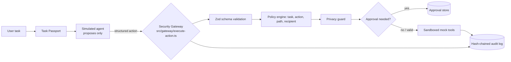

# Architecture

## Decision order (policy-engine.ts)
1. Task exists and is active → else block. 2. Explicit deny → block. 3. Not in permitted list → block (deny-by-default).
4. Path actions: sandbox boundary → allowed paths → write scope. 5. Outbound: recipient allowlist → privacy scan → block / require approval / allow.
6. `approvalRequired` → require approval. 7. Otherwise allow.

## Approval lifecycle
`pending → approved → consumed` (or `rejected | expired | invalidated`). The gateway re-runs policy + privacy, recomputes the payload hash, and consumes the approval with a conditional update (`WHERE status='approved'`) so concurrent replays lose the race.

## Layers
`app/` + `components/` = frontend. `app/api/` = thin HTTP layer. `src/` = server-only logic. `src/store/` has a `Store` interface with `PrismaStore` (app) and `MemoryStore` (tests).
